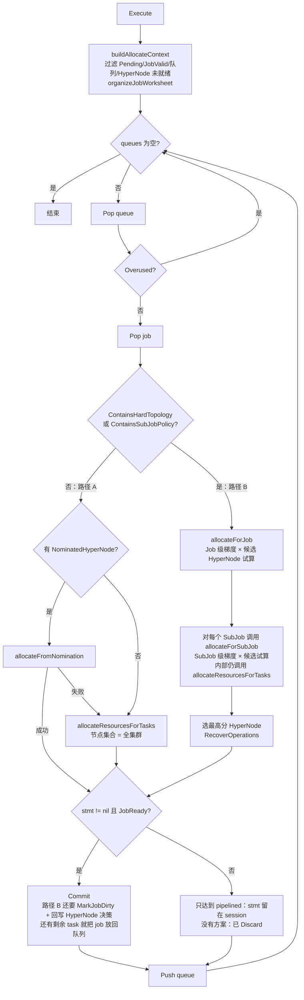

# 01 · allocate action 精读（v1.9 → v1.15）

> 源码：`pkg/scheduler/actions/allocate/allocate.go`。v1.9 版 309 行，v1.15.3 版 995 行；另有 `recorder.go` 114 行。
> 行号均对应 tag **v1.15.3**；以 `v1.9:` 开头的引用对应 tag v1.9.0。

---

## 0. 先给结论：两条路径

v1.15 的 allocate 看起来复杂，是因为它把**两套分配流程**塞进了同一个文件：

| | 路径 A："老路径" | 路径 B："拓扑 / SubJob 路径" |
|---|---|---|
| 适用的作业 | 没有网络拓扑约束，也没有 `subGroupPolicy` 的普通作业 | `ContainsHardTopology() \|\| ContainsSubJobPolicy()` 为真的作业 |
| 入口 | `allocateResourcesForTasks(defaultSubJob, tasks, ClusterTopHyperNode)` | `allocateForJob(job, worksheet, ClusterTopHyperNode)` |
| 与 v1.9 的关系 | 与 v1.9 的 `allocateResourcesForTasks` 几乎一一对应：节点集合等于全部节点，再加若干小改动 | 全新流程：按 HyperNode 梯度试算（dry-run），选出最优方案后重放 |

**目前内部生产环境没有用到 HyperNode 和 subGroupPolicy，作业全部走路径 A。** 建议先读懂路径 A（第 3 节），路径 B（第 4 节）可以在需要拓扑调度时再看。

需要注意一个容易误解的点：session 打开时，soft 模式的网络拓扑会被**改写成 hard 模式**（`pkg/scheduler/framework/session.go:1066-1121`），所以 soft 拓扑作业同样走路径 B。变量名 `tasksNoHardTopology` 里的 "NoHard" 实际含义是"不带任何拓扑约束"。

---

## 1. 读代码前要知道的 6 个新概念

| 概念 | 一句话解释 | 定义位置 |
|---|---|---|
| **SubJob** | Job 内的"子 gang"。PodGroup 的 `spec.subGroupPolicy` 按标签把 Pod 切成若干组，每组有自己的 minAvailable 和拓扑约束 | `pkg/scheduler/api/sub_job_info.go:40-60` |
| **默认 SubJob** | **每个 Job 都至少有一个 SubJob**。没有 subGroupPolicy 时，所有 task 都属于默认 SubJob，其 ID 等于 job UID，MinAvailable 等于 job.MinAvailable。所以路径 A 里出现的 `subJob` 其实就是"整个 job" | `pkg/scheduler/api/job_info.go:1299-1321` |
| **HyperNode** | 网络拓扑节点，例如交换机，按 tier 分层，tier 越小网络越近。叶子挂真实 Node | CRD `topology.volcano.sh/v1alpha1`，详见 [03](./03-network-topology-hypernode-subjob.md) |
| **ClusterTopHyperNode** | session 里虚拟出来的根 HyperNode `<cluster-top-hypernode>`，它的 RealNodes 等于集群全部节点。路径 A 传入它，效果就等同于 v1.9 的 `ssn.NodeList` | `session.go:56-62, 286-314` |
| **Gradient（梯度）** | 插件返回的候选 HyperNode 列表，按 tier 从低到高分层，类型为 `[][]*HyperNodeInfo`。allocate 先在最低层找解，找不到再往上一层 | `session_plugins.go:1116-1153` |
| **Statement 的 Save / Recover** | `SaveOperations` 把一组操作深拷贝成离线"方案"，`Discard` 撤销它在 session 里的副作用，`RecoverOperations` 在新的 Statement 上重放该方案。这是"多方案试算、选最优"的基础 | `pkg/scheduler/framework/statement.go:423-472` |

---

## 2. 入口与数据结构

### 2.1 Execute

```go
// pkg/scheduler/actions/allocate/allocate.go:122-140（节选）
func (alloc *Action) Execute(ssn *framework.Session) {
	...
	alloc.parseArguments(ssn)           // 新增：读取 predicateErrorCacheEnable 参数
	...
	alloc.session = ssn
	alloc.recorder = NewRecorder()      // 新增：记录 HyperNode 决策，只在路径 B 使用
	actx := alloc.buildAllocateContext()  // 对应 v1.9 的 pickUpQueuesAndJobs
	alloc.allocateResources(actx)
}
```

action 参数只有一个，`predicateErrorCacheEnable`，默认 true。它控制同一个 TaskRole 的谓词失败结果是否缓存，见 `allocate.go:117-120` 和 `pkg/scheduler/util/predicate_helper.go:45-54`。

### 2.2 allocateContext 与 Worksheet

```go
// pkg/scheduler/actions/allocate/allocate.go:41-51（节选）
type allocateContext struct {
	queues              *util.PriorityQueue                 // 队列优先队列（QueueOrderFn）
	jobsByQueue         map[api.QueueID]*util.PriorityQueue // 每个队列下的 job 优先队列（JobOrderFn）
	jobWorksheet        map[api.JobID]*JobWorksheet         // 每个 job 的"待办"
	tasksNoHardTopology map[api.JobID]*util.PriorityQueue   // 路径 A 专用：默认 SubJob 的 task 队列
}

type JobWorksheet struct {
	subJobs          *util.PriorityQueue                 // SubJob 优先队列
	subJobWorksheets map[api.SubJobID]*SubJobWorksheet   // 每个 SubJob 的 task 优先队列
}
```

用 v1.9 的概念来对照：

- v1.9 的 `jobsMap` 对应 v1.15 的 `jobsByQueue`。
- v1.9 的 `pendingTasks[job]`（在 allocateResources 里懒加载）对应 v1.15 的 `jobWorksheet[job].subJobWorksheets[subJob].tasks`（提前构建）。
- v1.15 多出来的一层是 **SubJob**。路径 A 只用到默认 SubJob 那一层，`tasksNoHardTopology[job]` 就是指向它的快捷引用（`allocate.go:196-202`）。

`Clone()` 和 `ShallowCopyFrom()` 只在路径 B 中使用：试算时克隆一份 worksheet，选定方案后再把剩余的待办"继承"回原 worksheet。

---

## 3. 路径 A：普通作业的完整流程

### 3.1 buildAllocateContext：收集作业

在 `allocate.go:142-205`，与 v1.9 `pickUpQueuesAndJobs`（`v1.9:allocate.go:68-103`）逐条对照如下：

| 步骤 | v1.9 | v1.15 |
|---|---|---|
| Pending 的 PodGroup | 配置了 enqueue action 就跳过；没配置则直接置为 Inqueue | 相同（`:153-164`） |
| `ssn.JobValid` | 跳过 | 相同（`:166-169`）。另外，v1.9 在 openSession 里也调过一次 JobValid，v1.15 删掉了那次，只保留各 action 内的检查 |
| 找不到队列 | 跳过 | 相同（`:171-175`） |
| HyperNode 缓存没就绪，且作业带拓扑约束 | — | **新增**：跳过（`:177-181`） |
| 组织 task | 在 allocateResources 中懒加载 | **新增**：调用 `organizeJobWorksheet` 一次性构建；worksheet 为空（没有可分配的 task）的作业**不会进入队列**（`:183-186`） |

`organizeJobWorksheet`（`:208-281`）对每个 SubJob 构建 task 优先队列，过滤规则如下：

- 跳过 BestEffort task，即 `Resreq` 为空的 task。这一点 v1.9 也有。
- **新增**：跳过带"外部" schedulingGate 的 task。只带 Volcano 自己的队列准入 gate 的 task 保留，留给后面处理（`:256-263`）。
- 已经 ready 的 SubJob 不进队列。为满足 `minSubGroups` 必须先调度的 SubJob（`requireSubJobs`）排在最前面（`:211-249`）。这一条在路径 A 中没有作用。

### 3.2 allocateResources：主循环

```go
// pkg/scheduler/actions/allocate/allocate.go:283-368（节选）
for {
	queue := queues.Pop()
	if ssn.Overused(queue) { continue }        // 超用的队列被丢弃，本轮 action 不再处理（与 v1.9 相同）
	job := jobs.Pop()
	if job.ContainsHardTopology() || job.ContainsSubJobPolicy() {
		// 路径 B（第 4 节）
	} else {
		subJob := job.SubJobs[job.DefaultSubJobID()]
		tasks  := actx.tasksNoHardTopology[job.UID]
		if subJob.NominatedHyperNode != "" {   // gangpreempt/gangreclaim 留下的提名，走快速路径（第 5 节）
			stmt = alloc.allocateFromNomination(...)
		}
		if stmt == nil {
			stmt = alloc.allocateResourcesForTasks(subJob, tasks, ClusterTopHyperNode)
		}
		if stmt != nil && ssn.JobReady(job) {
			stmt.Commit()
			if tasks.Len() > 0 { jobs.Push(job) } // 已满足 minAvailable 但还有剩余 task：放回队列，下次继续
		}
	}
	queues.Push(queue)   // 处理完一个 job 后，把队列放回去重新排序
}
```

与 v1.9（`v1.9:allocate.go:108-166, 276-288`）的差异：

1. **Commit 的位置变了。** v1.9 在 `allocateResourcesForTasks` 内部执行 Commit 或 Discard。v1.15 中，`allocateResourcesForTasks` 只**返回** stmt，由调用方决定是否 Commit。原因是路径 B 需要先试算、后决定。
2. **仅 Pipelined 的作业处理方式不变。** `stmt != nil` 但 `JobReady` 为假（只达到 pipelined）时，既不 Commit 也不 Discard。这些操作留在 session 里，相当于"占位"，与 v1.9 相同（v1.9 在 `!JobPipelined` 时才 Discard）。
3. **放回 job 的时机。** v1.9 是在 task 循环里，`JobReady && !tasks.Empty()` 时放回 job 并 break。v1.15 是在 Commit 之后、`tasks.Len() > 0` 时放回。两者效果一样，都是"先凑够 gang，再分批补齐剩余副本"。
4. **放回 queue 的时机。** v1.9 在分配**之前**放回 queue（`v1.9:allocate.go:155`），v1.15 在分配**之后**放回。v1.15 的写法让 QueueOrderFn 能基于最新的分配结果重新排序。

### 3.3 allocateResourcesForTasks：逐个 task 选节点

位置在 `allocate.go:719-867`。下表是**一个 task 的处理过程**，左边对照 v1.9（`v1.9:allocate.go:168-280`）：

| 顺序 | v1.9 | v1.15 | 说明 |
|---|---|---|---|
| 0 | `allNodes = ssn.NodeList` | `nodes = ssn.RealNodesList[hyperNode]`（`:724-728`） | 路径 A 中 hyperNode 是 ClusterTop，因此等于全部节点 |
| 1 | `ssn.Allocatable(queue, task)`，不通过就 continue | 相同（`:744-747`） | 队列配额检查，capacity / proportion 插件在这里起作用 |
| 2 | — | **队列准入 gate**（`:749-765`）：如果 task 带 Volcano gate 且有 opt-in 注解，异步移除 gate；**本轮仍跳过**仍带 gate 的 task | 需开启 feature gate `SchedulingGatesQueueAdmission`，默认关闭。详见 [05](./05-queue-capacity-enqueue.md) |
| 3 | — | **按角色跳过**：`job.TaskHasFitErrors(subJob, task)`（`:767-775`） | 同一个 TaskRole（来自 `volcano.sh/task-spec`）已经谓词失败过的，直接跳过，不再重复计算 |
| 4 | `PrePredicateFn` 失败就 **break** | 失败后用 `job.NeedContinueAllocating(subJob)` 决定 continue 还是 break（`:779-790`） | 见 3.4 节 |
| 5 | — | **先试 NominatedNodeName**（`:795-804`）：Pod 的 `status.nominatedNodeName` 在候选集里且 FutureIdle 放得下时，只对这一个节点做谓词检查 | 移植自 kube-scheduler；提名来自 preempt/reclaim 的 Pipeline |
| 6 | `PredicateNodes(task, allNodes, ...)` | 相同，多传了 `enablePredicateErrorCache` 和 `ssn.NodesInShard`（`:807-809`） | hard 分片模式下，分片外的节点直接判为失败 |
| 7 | 没有可行节点就 **break** | 同样用 `NeedContinueAllocating` 决定（`:811-829`） | 失败时 FitErrors 里会记录 hyperNode 名 |
| 8 | — | 带拓扑约束时设置 `task.JobAllocatedHyperNode`（`:831-833`） | 供 network-topology-aware 插件给节点打分 |
| 9 | 在函数内直接写两级候选（idle / futureIdle）和打分 | 抽成 `prioritizeNodes`（`:882-951`），**扩成四级候选** | 见 3.5 节 |
| 10 | 直接调用 `stmt.Allocate` / `stmt.Pipeline` | 抽成 `allocateResourcesForTask`（`:953-982`） | 逻辑相同：Idle 放得下就 Allocate，否则 FutureIdle 放得下就 Pipeline |
| 11 | `JobReady && 还有 task` 时放回 job 并 break | `ssn.SubJobReady(job, subJob)` 时 break（`:849-851`） | 没有 subGroupPolicy 时，`SubJobReady` 等价于 `JobReady`（`session_plugins.go:424-427`） |
| 12 | 在函数内 Commit / Discard | ready 或 pipelined 时返回 stmt；否则 `stmt.Discard()` 并返回 nil（`:854-866`） | — |

### 3.4 NeedContinueAllocating：一个 task 失败后是否继续

v1.9 中，只要有一个 task 的 PrePredicate 或 Predicate 失败，就直接 break，同一个 job 剩下的 task 都不再尝试。v1.15 改为调用 `NeedContinueAllocating`（`pkg/scheduler/api/job_info.go:963-` 起），规则如下：

- `MinAvailable == len(Tasks)`，即要求全部 task 都起来：一个失败就不可能满足 gang，**break**。
- SubJob 的 MinAvailable ≥ 该 SubJob 的 task 数：同理，**break**。
- 带 subGroupPolicy 的作业：**continue**。
- 其余情况：根据失败的角色，以及剩余可分配的数量能否满足各角色的 minMember 来判断。

目的是让"部分副本放不下、但剩下的副本仍能凑够 minAvailable"的弹性作业继续分配。

### 3.5 prioritizeNodes：四级候选

```go
// pkg/scheduler/actions/allocate/allocate.go:913-921（节选）
// 1. 本调度器分片内、Idle 足够的节点
// 2. 其他分片内、Idle 足够的节点（只有 soft 分片模式才非空）
// 3. 本调度器分片内、FutureIdle 足够的节点
// 4. 其他分片内、FutureIdle 足够的节点（只有 soft 分片模式才非空）
```

- 依次处理每一级：只有 1 个节点时直接选它；有多个时用 `PrioritizeNodes`（BatchNodeOrder + NodeOrderMap/Reduce）打分，再用 `BestNodeFn` 或 `SelectBestNodeAndScore` 选出最优。**一旦某一级选出了节点，就不再看后面的级别。**
- 没有开启调度器分片（默认 `--scheduler-sharding-mode=none`）时，第 2、4 级为空，行为与 v1.9 的"两级候选"完全一致。

### 3.6 predicate：签名变了

```go
// pkg/scheduler/actions/allocate/allocate.go:984-993（节选）
func (alloc *Action) predicate(task *api.TaskInfo, node *api.NodeInfo) error {
	if ok, resources := task.InitResreq.LessEqualWithResourcesName(node.FutureIdle(), api.Zero); !ok {
		return api.NewFitErrWithStatus(task, node, &api.Status{Code: api.Unschedulable, Reason: ...})
	}
	return alloc.session.PredicateForAllocateAction(task, node)
}
```

- `api.PredicateFn` 的签名从 `func(*TaskInfo,*NodeInfo) ([]*Status, error)` 改成了 `func(*TaskInfo,*NodeInfo) error`（`pkg/scheduler/api/types.go:315`；`v1.9:api/types.go:170`）。状态码放进 FitError 中。
- v1.9 在 allocate 内部判断 `ContainsUnschedulable()` 等状态码。v1.15 把这类判断收拢到 Session 的两个方法里：
  - `PredicateForAllocateAction`（`session.go:666-683`）：Unschedulable 即失败。
  - `PredicateForPreemptAction`（`session.go:688-706`）：只有 UnschedulableAndUnresolvable 才失败，因为 Unschedulable 有可能通过驱逐解决。

**内部插件迁移时注意**：所有通过 `AddPredicateFn` 注册的插件，都要改成新签名。

---

## 4. 路径 B：拓扑 / SubJob 作业

### 4.1 核心模式：先试算所有候选，再重放最优

路径 B 的两个函数 `allocateForJob` 和 `allocateForSubJob` 都遵循同一个模式：

```text
for 每一层梯度（tier 从低到高）:
    for 该层中的每个候选 HyperNode hn:
        在 hn 范围内尝试分配                     // 操作真实写进 session
        如果成功: 备份 = SaveOperations(stmt)    // 深拷贝成离线方案
        stmt.Discard()                          // 撤销 session 中的副作用，保证下一个 hn 从干净状态开始
    如果本层有至少一个成功的方案:
        best = 打分最高的 hn
        final = NewStatement(); final.RecoverOperations(备份[best])  // 在 session 中重放最优方案
        return final
    否则: 继续下一层（放宽到更大的网络域）
return nil
```

所以，**"能放进越小的网络域越好"** 是由"梯度从低 tier 到高 tier 依次尝试"保证的；**同一层内多个候选之间选哪个**则由打分决定。

### 4.2 allocateForJob（Job 级，`allocate.go:370-463`）

1. `recorder.SnapshotSubJobStatus`：记录每个 SubJob 当前的 `AllocatedHyperNode`。试算会修改这个字段，每个候选算完都要恢复。
2. `ssn.HyperNodeGradientForJobFn(job, ClusterTop, PurposeAllocate)` 得到 Job 级梯度。这个函数由 network-topology-aware 插件实现：它剔除 tier 超过 `highestTierAllowed` 的 HyperNode，以及资源明显不够（`minResource` 大于 idle/futureIdle）的 HyperNode。
3. 对每个候选 HyperNode：
   - `job.ResetFitErr()`，克隆 worksheet；
   - 按 SubJob 优先级依次调用 `allocateForSubJob(subJob, ws, hn)`。注意它返回的 stmt **已经重放到 session 中**，所以后一个 SubJob 能看到前一个 SubJob 占用的资源；
   - SubJob 还有剩余 task 就放回队列；`JobReady` 后停止；
   - `RecoverSubJobStatus`；`SaveOperations(stmtList...)`；只有 `JobReady || JobPipelined` 的方案才会被备份；
   - 对本候选产生的所有 stmt 执行 Discard。
4. `selectBestHyperNodeForJob`：比较各候选下"各 SubJob 得分之和"，取最高的（`:541-558`）。
5. 执行 `RecoverOperations`，用 `jobWorksheet.ShallowCopyFrom(备份)` 继承剩余的待办，调用 `recorder.SaveJobDecision`。

回到 `allocateResources`（`:308-323`）：只有 `JobReady` 时才会依次执行 `stmt.Commit()`、`ssn.MarkJobDirty(job.UID)` 和 `recorder.UpdateDecisionToJob(job, ssn.HyperNodes)`。最后一步把胜出方案的 HyperNode 写到 `job.AllocatedHyperNode` 和各 SubJob 的 `AllocatedHyperNode` 上（取 LCA，即最近公共祖先）。session 关闭时，这些值会写回 cache。

### 4.3 allocateForSubJob（SubJob 级，`allocate.go:465-539`）

1. 如果有 `NominatedHyperNode`，先走提名快速路径（第 5 节）。
2. `ssn.HyperNodeGradientForSubJobFn(subJob, hyperNodeForJob, PurposeAllocate)`：搜索范围限定在 Job 级候选 HyperNode 的子树内。
3. 对每个候选：克隆 task 队列，调用 `allocateResourcesForTasks(subJob, tasks, hn.Name)`（与路径 A 是同一个函数，只是节点集合换成 hn 下的节点），然后 Save 并 Discard。
4. `selectBestHyperNodeForSubJob`：用 `HyperNodeOrderMapFn` 给候选 HyperNode 打分（network-topology-aware 插件按 HyperNode 级 binpack 打分）；分数并列时随机选一个。
5. 执行 Recover；`subJob.AllocatedHyperNode = LCA(旧值, best)`；调用 `recorder.SaveSubJobDecision`。

### 4.4 Recorder 是做什么的

位置在 `recorder.go:25-114`。它是 action 级的临时对象，每次执行 Execute 都会新建：

- 试算过程中，SubJob 的 `AllocatedHyperNode` 会被反复改写。Recorder 负责快照和恢复，保证不同候选之间互不干扰。
- 它按"Job 级候选 HyperNode"分桶记录 SubJob 的决策，最终只应用胜出那个桶里的决策（`UpdateDecisionToJob`）。

### 4.5 复杂度提示

路径 B 的开销大致是：Job 级候选数 × SubJob 数 × SubJob 级候选数 × task 数 × 节点数，每次还伴随一次 Save/Discard/Recover。network-topology-aware 插件的资源预过滤，以及"找到一层就停"的规则，是控制开销的关键。大集群开启拓扑调度前，建议先压测。

---

## 5. 提名快速路径（allocateFromNomination）

位置在 `allocate.go:590-717`。

- **来源**：gangpreempt / gangreclaim 在驱逐了一组受害者之后，给 SubJob 设置 `NominatedHyperNode`，并通过 Pipeline 让 Pod 带上 `status.nominatedNodeName`。详见 [04](./04-preempt-reclaim-gang-eviction.md)。
- **快速路径**：不再做梯度搜索，直接检查每个 pending task 是否满足以下条件：有 NominatedNodeName、该节点在被提名 HyperNode 的叶子集合内、Allocatable 通过、PrePredicate 通过、Predicate 通过。全部满足就按这个方案直接分配。
- **任何一项不满足**：`invalidateSubJobNomination` 清空提名，回退到常规路径。
- **v1.15.3 的已知缺陷**：`NominatedHyperNode` 只保存在内存中。session 关闭时，`cache.updateJobInfo` 只写回 `AllocatedHyperNode`（`pkg/scheduler/cache/cache.go:1732-1744`），所以下一轮 session 里提名信息已经丢失，快速路径实际上很难触发；能跨轮保留的只有 Pod 的 `nominatedNodeName`。上游 master 已经修复：[#5476](https://github.com/volcano-sh/volcano/pull/5476)（commit `691bd2d88`，"persist and prioritize subJob.NominatedHyperNode across cycles"）。**如果要启用 gangpreempt / gangreclaim，建议同时 cherry-pick 这个修复。**

---

## 6. 全景流程图



---

## 7. v1.9 → v1.15 行为差异清单（升级时最容易踩坑的点）

| # | 差异 | 影响 |
|---|---|---|
| 1 | `PredicateFn` 签名改为只返回 `error`；allocate 使用 `PredicateForAllocateAction` | 所有自研插件的谓词函数都要改 |
| 2 | 谓词错误缓存（`predicateErrorCacheEnable`，默认开启），只对有 TaskRole 的 Pod 生效 | 同角色的 Pod 只要有一个在某节点失败，其他同角色 Pod 会直接复用这个结果。如果自研谓词依赖 Pod 级别的差异（例如 Pod 注解），需要关闭缓存或保证 TaskRole 能区分这些 Pod |
| 3 | `TaskHasFitErrors`：同角色已失败的 task 直接跳过 | 同上 |
| 4 | 失败后不再一律 break，改由 `NeedContinueAllocating` 决定 | 弹性作业的分配结果可能和 v1.9 不同 |
| 5 | 优先尝试 `nominatedNodeName` | 被抢占出来的节点会优先给 preemptor 使用 |
| 6 | 跳过带外部 schedulingGate 的 task；Volcano 队列准入 gate 采用异步移除 | 只有开启 `SchedulingGatesQueueAdmission` 时才生效 |
| 7 | HyperNode 缓存未就绪时，带拓扑约束的作业本轮跳过 | 生产环境不使用 HyperNode 时无影响 |
| 8 | 调度器分片下的四级候选 | 默认 `none` 模式下无影响 |
| 9 | `JobValid` 只在各 action 内检查，openSession 不再检查 | 依赖 openSession 过滤的自研逻辑需要调整 |
| 10 | Commit 由调用方决定，`allocateResourcesForTasks` 只返回 stmt | 自研代码如果在 allocate 里插入了逻辑，插入位置需要重新确认 |
| 11 | `Statement.Pipeline` 多了 `evictionOccurred` 参数；`Evict` 不再返回 error | 见 [02](./02-framework-session-statement.md) |

---

## 8. 对内部 fork 迁移的提示

内部 allocate.go 有 1340 行，以下内部改动需要和上面的新结构对齐：

- **`Overused(queue, req)`**：内部把 Overused 扩展为带候选请求的版本，并在 job 级和 SchedulingUnit 级调用。上游 v1.15 只在队列级调用 `ssn.Overused(queue)`（`:294`），而且**社区 capacity 插件根本没有注册 OverusedFn**，配额限制全部依赖 `Allocatable`。迁移时需要决定，是保留内部的 Overused 语义，还是把它并入 Allocatable。
- **replica-gang 和 SchedulingUnit**（内部的 `allocate_replica_gang.go`）：建议做成 `allocateResources` 中与路径 A、路径 B 并列的第三个分支，不要侵入 `allocateResourcesForTasks`。
- **ActionExcluded 门控**：适合放在 `buildAllocateContext` 里跳过作业，位置和 `JobValid`、HyperNode 就绪检查相同。
- **skip-if-unchanged、调度原因记录**：上游 allocate 的 `recorder` 名字相同但用途不同（它记录的是 HyperNode 决策），注意不要混淆。
- **SubJob 与内部 replica-gang 的语义重叠**：上游的 `subGroupPolicy`（加上 `minSubGroups`）本质上就是"子 gang"，和内部的 replica-gang 很接近。长期看可以评估是否改用上游的 SubJob 模型，从而减少自研代码。

---

## 9. 调试建议

- `-v=3` 下可以看到主要的决策日志，可按以下关键字搜索：
  - `Try to allocate resource for job contains hard topology or subjob policy`（路径 B）
  - `Try to allocate resource`（路径 A）
  - `Allocate job to hyperNode success`
  - `Queue <x> is overused`
- `-v=4` / `-v=5` 可以看到各候选 HyperNode 的试算过程（`Find solution for job fail` / `gradient`），以及节点级打分。
- 单测 `allocate_test.go`（6000 多行）中有大量构造好的场景，可以直接参照，例如搜索 `NominatedHyperNode`、`subGroupPolicy`、`networkTopology`。
