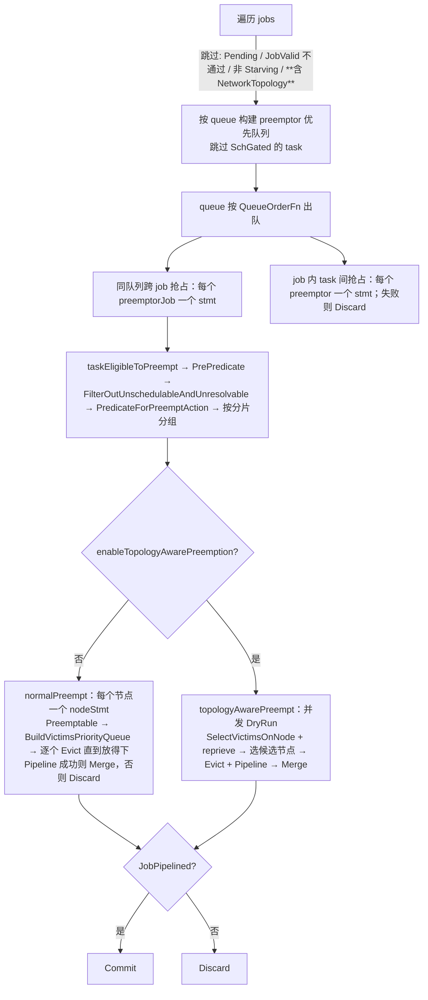
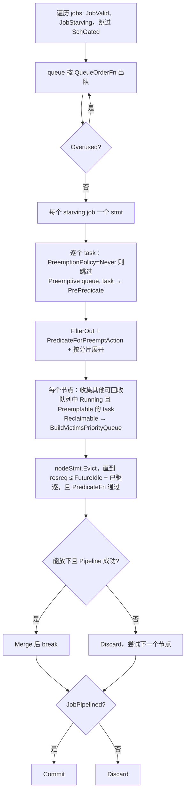

# 04 · 驱逐类 action：preempt / reclaim / gangpreempt / gangreclaim

> 行号对应 tag **v1.15.3**；以 `v1.9:` 开头的引用对应 v1.9.0。

## 0. 总览

| 主题 | v1.9 | v1.15 |
|---|---|---|
| 驱逐类 action | `preempt`、`reclaim`、`shuffle` | 新增 **`gangpreempt`、`gangreclaim`**（注册在 `actions/factory.go`） |
| 驱逐粒度 | 逐个 task | 旧的两个 action 仍逐个 task；新的两个 action 以 **job / bundle** 为单位，并按 HyperNode 划定搜索范围 |
| 事务 | reclaim 直接调用 `ssn.Evict`，无法回滚 | 全部改用 Statement：每个节点一个子 stmt，成功则 `Merge` 进父 stmt，失败则 `Discard` |
| 提名 | 无 | Pipeline 带 `evictionOccurred` 参数，把提名写入 Pod 的 `status.nominatedNodeName`；SubJob 级新增 `NominatedHyperNode` |
| VictimTasks（tdm / rescheduling / pdb 插件给出的受害者） | preempt 结束时调用 | **preempt 不再调用**，只剩 `shuffle` 调用 |

---

## 1. preempt（同队列内抢占）

### 1.1 新增参数（`actions/preempt/preempt.go:50-99`）

| key | 默认值 | 作用 |
|---|---|---|
| `predicateErrorCacheEnable` | true | 谓词错误缓存 |
| `enableTopologyAwarePreemption` | false | 启用 kube-scheduler 风格的"DryRun + Reprieve"抢占流程 |
| `topologyAwarePreemptWorkerNum` | 16 | DryRun 并发数 |
| `minCandidateNodesPercentage` / `minCandidateNodesAbsolute` / `maxCandidateNodesAbsolute` | 10 / 1 / 100 | 候选节点数的上下限 |

### 1.2 流程



### 1.3 与 v1.9 的关键差异

1. **跳过带 NetworkTopology 的作业**（`:132-137`，TODO 对应 issue #4374）。拓扑作业的抢占要用 gangpreempt。
2. **queue 改为按 QueueOrderFn 排序**（`:154-159`）。v1.9 遍历的是 map，顺序随机。
3. **`taskEligibleToPreempt`**（`:438-475`，从 kube-scheduler 移植）：
   - `PreemptionPolicy=Never` 的 task 不允许抢占；
   - 如果 task 已有 nominatedNodeName，且那个节点上已经有因抢占而处于 Terminating 状态的低优 Pod，就不再重复抢占。
4. **选节点**：
   - 复用 allocate 留下的 fit error，剔除不可解决的节点；
   - 用 `PredicateForPreemptAction`，`Unschedulable` 的节点不会被排除，因为驱逐之后可能变得可用；
   - 按分片分组。
5. **normalPreempt 的放置判断**：判断能否放下的条件是 `Allocatable && InitResreq ≤ FutureIdle && PredicateFn == nil`（`:432-436`）。新增的 PredicateFn 是为了处理 vGPU / vNPU 碎片化：显存总量够，但单卡放不下的情况。
6. **事务化**：每个节点用一个 `nodeStmt`，Pipeline 失败就 Discard 后换下一个节点。v1.9 中 Pipeline 失败也被当作已分配。
7. **job 内 task 间抢占**：
   - 增加 `!task.Preemptable` 过滤；
   - 失败时 **Discard**。v1.9 无论成败都会 Commit。
8. **不再调用 `victimTasks`**。依赖 tdm 或 rescheduling 插件驱逐的集群，需要配置 `shuffle` action。

### 1.4 拓扑感知抢占（`enableTopologyAwarePreemption`）

- 设计文档：`docs/design/preempt-action-support-topology.md`。注意这里的"拓扑"指 **k8s 的亲和性和 PodTopologySpread，与 HyperNode 无关**。
- 每个节点上的流程（`SelectVictimsOnNode`，`:718-852`）：
  1. 在 CycleState 副本上通过 `SimulateRemoveTaskFn` 移除所有候选受害者；
  2. 判断 preemptor 能否放下；
  3. 按优先级从高到低，逐个尝试把受害者放回去（reprieve），能放回的就不驱逐。
- 选节点规则与 kube-scheduler 相同：依次比较受害者最高优先级最小、优先级之和最小、受害者数量最少、启动时间最晚。

### 1.5 nominatedNodeName 的来龙去脉

1. `Statement.Pipeline(task, node, evictionOccurred=true)` 写入 `task.EvictionOccurred`。
2. session 结束时，`JobInfo.TaskSchedulingReason` 对处于 Pipelined 状态且发生过驱逐的 task，返回 `nominatedNodeName` 等于该节点（`api/job_info.go:870-875`）。
3. cache 把它写入 Pod status（`cache/cache.go:1677-1682, 1095-1109`）。只有新值非空时才覆盖，避免被后续 session 清空。
4. 下一轮 allocate 优先尝试这个节点（`allocate.go:795-804`）。

---

## 2. reclaim（跨队列回收）



| 对比点 | v1.9 | v1.15（`actions/reclaim/reclaim.go`） |
|---|---|---|
| preemptor 条件 | `HasPendingTasks` | `JobStarving`，并跳过 SchGated |
| 粒度 | 每次出队只处理一个 task，然后把 job 和 queue 放回 | 每个 job 一个 stmt，循环到 job 不再 starving |
| Preemptive | `ssn.Preemptive(queue)` | `ssn.Preemptive(queue, []*TaskInfo{task})`，**按 task 判断** |
| Allocatable | 显式调用 `ssn.Allocatable(queue, task)` | **reclaim 里不再调用**，配额判断完全交给 PreemptiveFn |
| 驱逐 | `ssn.Evict`，立即生效且不可回滚 | `nodeStmt.Evict` + Pipeline + Merge；外层只有在 `JobPipelined` 时才 Commit |
| 停止条件 | 已驱逐资源 ≥ resreq（不考虑节点原有的空闲资源） | `resreq ≤ FutureIdle + 已驱逐`，且 PredicateFn 通过 |
| 受害者排序 | `BuildVictimsPriorityQueue(victims)` | 多一个 preemptor 参数；跨队列时使用 VictimQueueOrderFn |

**对内部的影响**：内部的 reclaim 有 ReclaimOrder、BatchVictimScore、VictimProtection、Coeviction 等扩展，而且依赖 `Preemptive(queue, job/task)` 的语义。上游现在的签名是 `Preemptive(queue, []*TaskInfo)`，与内部写法接近，可以对齐。但 **reclaim 不再调用 Allocatable** 这一点必须留意：内部 capacity 在 Allocatable 中做的判断，需要确认是否在 Preemptive 中有同样的覆盖。

---

## 3. gangpreempt / gangreclaim（v1.15 新增）

### 3.1 要解决的问题

设计文档：`docs/design/gang-aware-eviction-design.md`。

- 旧的 preempt / reclaim 按 task 逐个驱逐，一轮下来可能从很多个 gang 里各杀掉一个 task，而目标 gang 仍然放不下。被杀的 gang 也因为少了成员而失效，两边都没得到好处。
- 拓扑约束要到很晚才检查。

新方案的思路：

1. 先用 `HyperNodeGradientForJobFn(..., PurposeEvict)` 选出几个 HyperNode 作为**搜索域**。
2. 在每个域内，以 **bundle** 为单位选受害者：
   - **safe bundle**：驱逐后对方 gang 仍然保持 ready；
   - **whole bundle**：要驱逐就得把对方整个 job 一起驱逐。
3. 模拟放置成功后，在一个事务里完成驱逐和提名。

### 3.2 配置

| key | 默认值 | 说明 |
|---|---|---|
| `maxDomains` | 8 | 每个 job 最多扫描的 HyperNode 域数量 |
| `allowWholeBundle` | true | 是否允许驱逐整个 gang |
| `predicateErrorCacheEnable` | 读取的是 **allocate** 的配置 | — |

```yaml
actions: "enqueue, allocate, backfill, gangpreempt, gangreclaim"
configurations:
- name: gangpreempt
  arguments: {maxDomains: 8, allowWholeBundle: true}
```

- **action 名区分大小写**，必须写成全小写的 `gangpreempt` / `gangreclaim`。设计文档示例里写的是 `gangPreempt`，照抄会导致**调度器启动失败**。
- 设计文档要求不要与旧的 `preempt` / `reclaim` 同时配置，但**代码没有做互斥校验**。

### 3.3 算法（以 gangpreempt 为例，括号中是 gangreclaim 的不同之处）

1. 收集 starving 的 job，按 queue 放进 JobOrder 优先队列。每个 job 只尝试一次。
2. 计算需求：`CollectPendingTasksForGangEviction`（`actions/utils/simulate.go:373-424`）。job 已经 ready 时，只取第一个还有 pending task 的 SubJob。
3. 确定候选域：`GetCandidateDomains` 取梯度结果的前 `maxDomains` 个。没有硬拓扑约束的 job 回退为 ClusterTop。
4. 在每个域内挑选 bundle：
   1. 确定候选受害者：
      - gangpreempt：同队列，**job 优先级必须更低**（硬编码），且可被抢占；
      - gangreclaim：其他队列中处于 Running 的，且所在队列允许被回收。
   2. 用 `CreateJobBundles`（`actions/utils/bundle.go:53-192`）切分 bundle。判断"驱逐后对方是否仍满足 gang"时会同时检查三层：job 级 minAvailable、各 role 的 minMember、SubJob 的 minSubGroups。
   3. 第一次排序：safe 优先于 whole；然后 gangpreempt 按 `!JobOrderFn` 排（gangreclaim 按 VictimQueueOrderFn 排）；最后按 ROI 排。
   4. **每个域只调用一次** `ssn.UnifiedEvictable`，避免 capacity 这类有状态插件的累计账本被重置。
   5. 用 `ApplyAllowedTasks` 处理插件放行的结果：whole bundle 必须整体被放行；safe bundle 允许被缩小。
   6. 第二次排序。
5. 按顺序逐个累加 bundle，直到 `jobNeed ≤ Idle + Releasing + 已选中受害者的资源`，然后调用 `BuildNominationPlanInDomain`（`simulate.go:40-134`）做模拟：
   - 先驱逐全部受害者，再按 SubJob 逐个在 HyperNode 内模拟放置（硬拓扑的 SubJob 会继续做 SubJob 级梯度）；
   - Pipeline 时 `evictionOccurred=true`。
6. 模拟成功后，`stmt.RecoverOperations(plan)` 重放方案。如果 `JobPipelined`，就 Commit 并调用 `ApplySubJobNominations`，把 `NominatedHyperNode` 写到 SubJob 上。

### 3.4 UnifiedEvictableFn 的实现情况

类型定义在 `api/types.go:326-349`，`EvictionKind` 取值为 GangPreempt / GangReclaim / TaskPreempt / TaskReclaim。这个扩展点**没有 isEnabled 开关**。只注册了旧版 Preemptable / Reclaimable 的插件，**不会参与 gang 路径的过滤**，也没有兼容层。

| 插件 | 行为 |
|---|---|
| gang | 全部放行（gang 约束由 bundle 模型负责） |
| priority | GangPreempt 只放行优先级更低的；GangReclaim 全部放行 |
| capacity | GangPreempt 全部放行；GangReclaim 检查 guarantee 和 deserved |
| conformance | 排除 system-critical Pod 和 kube-system 命名空间 |
| proportion / drf / pdb / tdm | **未实现**。因此在 proportion 集群上，gangreclaim 的受害者不受 deserved 约束 |

### 3.5 已知问题

- **v1.15.3 中 `NominatedHyperNode` 不会回写到 cache**，所以 allocate 的提名快速路径在下一轮 session 中拿不到提名。上游 [#5476](https://github.com/volcano-sh/volcano/pull/5476)（commit `691bd2d88`）已修复。**启用 gang 驱逐时建议一并 cherry-pick。**
- `bundle.go` 中的 `SelectBundles` 没有被任何地方调用。

---

## 4. 签名变化汇总

| 函数 | v1.9 | v1.15 |
|---|---|---|
| `Statement.Evict` | 返回 `error` | 无返回值，Commit 时才真正执行驱逐 |
| `Statement.Pipeline` | `(task, host) error` | `(task, host, evictionOccurred bool) error`，出错时自动回滚 |
| `Preemptive` | `(queue) bool` | `(queue, candidates []*TaskInfo) bool` |
| `BuildVictimsPriorityQueue` | `(victims)` | `(victims, preemptor)` |
| `VictimQueueOrderFn` | — | 新增 `(l, r, preemptor) bool`，找不到实现时回退为 `!QueueOrderFn` |
| `UnifiedEvictable` | — | 新增 `(ctx *EvictionContext, candidates)` |
| `Simulate*Fn` | — | 新增 4 个，供拓扑感知抢占使用 |
| `Preemptable` / `Reclaimable` / `VictimTasks` / `Overused` | — | 签名不变（交集初始化逻辑的细节见 [02](./02-framework-session-statement.md) 2.2 节） |

## 5. 建议阅读顺序

1. `statement.go` 中的 Merge、SaveOperations、RecoverOperations；
2. `preempt.go` 的 `normalPreempt`；
3. `reclaim.go` 的 `reclaimForTask`；
4. `actions/utils/bundle.go`；
5. `actions/utils/simulate.go`；
6. `gangpreempt.go`；
7. `allocate.go` 的 `allocateFromNomination`。
