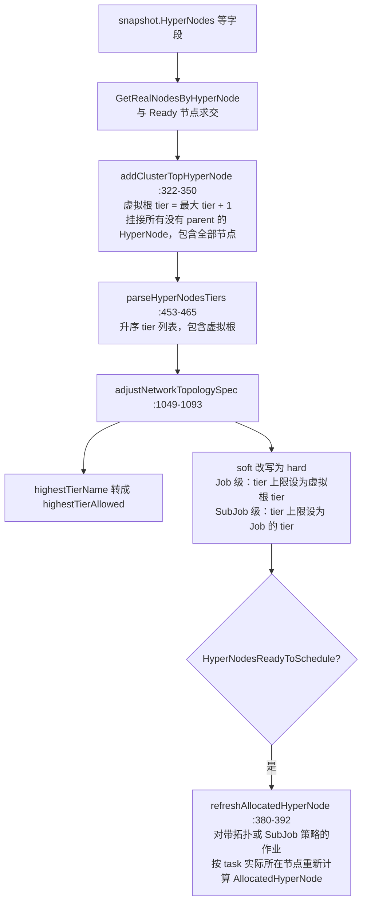
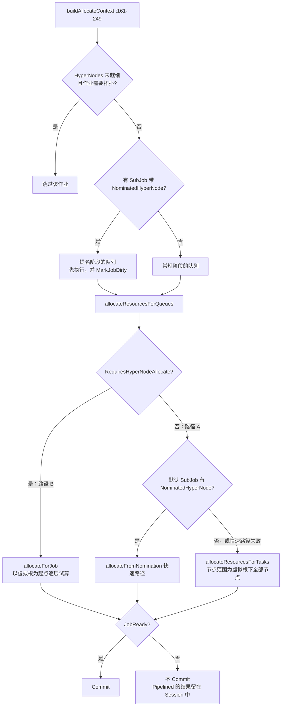
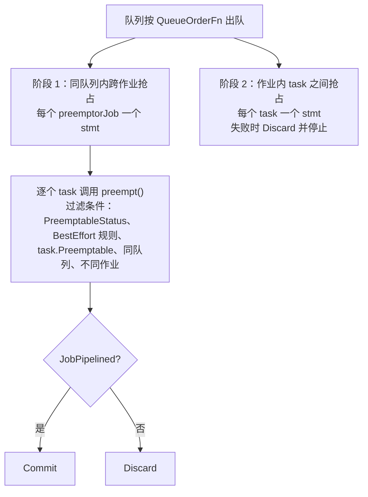
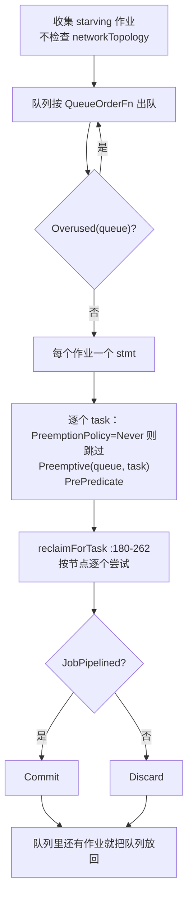
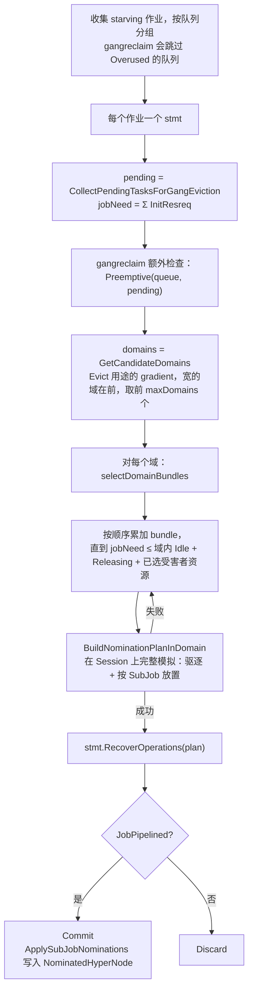
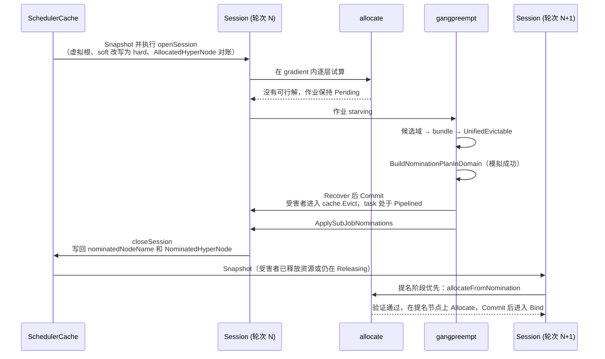

# 08 · 拓扑调度、抢占、回收：实现与框架准备（深入分析）

> **代码基线**：当前工作树 `v1.16.0-rc.0-3-g5ff4ec942`（分支 `learing`）。本篇所有行号都对应这个版本，**和 01–07 篇使用的 v1.15.3 行号不同**。
> 标"推断"的内容是读代码得出的结论，没有经过运行验证；标"已核实"的内容有源码或单测作证据。
> 前置阅读：[02](./02-framework-session-statement.md)（Statement）、[03](./03-network-topology-hypernode-subjob.md)（HyperNode / SubJob）、[04](./04-preempt-reclaim-gang-eviction.md)（驱逐 action 概览）。本篇把三块串起来，并补充 v1.16 的变化和发现的问题。

---

## 0. 结论速览

1. **三类能力共用同一套框架底座**：
   - Session 快照提供拓扑视图，包括 HyperNode 树、虚拟根和真实节点映射；
   - 插件通过扩展点注册各自的判断逻辑，Session 按 tier 聚合结果；
   - Statement 把"驱逐、Pipeline、分配"做成可回滚的事务，并支持离线试算后重放；
   - closeSession 把放置状态和提名写回 cache，供下一轮使用。
2. **拓扑调度的本质是"按梯度逐层试算"**：
   - 插件为 Job 或 SubJob 生成按 tier 分层的候选 HyperNode 列表（gradient），框架对所有插件的结果**取交集**。v1.15.3 只采用第一个插件的结果。
   - allocate 在同一层的每个候选 HyperNode 上试算一遍，打分选出最优，再重放方案。从最低层开始，找到可行解就停止。
3. **存在两套驱逐体系，二者互不感知**：
   - 旧体系是 `preempt` / `reclaim`：**按 task、按节点**驱逐，不感知 HyperNode。`preempt` 直接跳过带 networkTopology 的作业，`reclaim` 则**不跳过**。
   - 新体系是 `gangpreempt` / `gangreclaim`：**按 job 和 bundle、按 HyperNode 域**驱逐，会先完整模拟一遍放置，成功后才提交，并把选中的域写到 `SubJob.NominatedHyperNode`，供下一轮 allocate 走快速路径。
4. **抢占和回收的区别**：
   - 抢占发生在同一队列内，受害者由 `Preemptable` 过滤（gang、priority、drf、conformance 等插件），队列配额用 `Allocatable` 判断；
   - 回收发生在跨队列之间，受害者由 `Reclaimable` 过滤（capacity / proportion 按 deserved 判断），抢占方队列是否有资格回收由 `Preemptive` 判断，被回收的队列要求 `Reclaimable()=true`。
5. **"成功才提交"贯穿所有驱逐路径**：
   - 每个节点或每个域先开一个临时 Statement 试算，放得下才 Merge 到外层；
   - 外层只有在 `JobPipelined` 时才 Commit，否则整体 Discard。
   - 真正的 Pod 删除发生在 `Commit → cache.Evict` 中，是异步执行的。
6. **发现 6 个值得关注的问题**，详见第 8 节。最需要优先处理的三个：
   - `hypernode.gradient.evict.max-hypernodes` 参数在 v1.16 中已经**失效**（已核实）；
   - 某一 tier 的插件返回空受害者时**不构成否决**，后续 tier 仍可能选出受害者（已核实），conformance 和 priority 的保护因此可能被绕过；
   - 旧 `reclaim` 会替拓扑作业驱逐 HyperNode 域外的节点（推断）。

---

## 1. 框架为这三类能力做了哪些准备

### 1.1 调度周期骨架

```text
Scheduler.runOnce            scheduler.go:138-167
 ├─ OpenSession               framework/framework.go:59-90
 │   ├─ openSession           session.go:183-319      快照 + 拓扑预处理
 │   ├─ plugin.OnSessionOpen  framework.go:71-83      插件注册扩展点
 │   ├─ InitCycleState        session.go:847-867      为每个 pending task 建 CycleState
 │   └─ applyCachedSkips                              不可调度作业缓存
 ├─ for action in actions: action.Execute(ssn)        例：enqueue, allocate, gangpreempt, gangreclaim, backfill
 └─ CloseSession              framework.go:93-101
     ├─ plugin.OnSessionClose
     └─ closeSession          session.go:540-561      JobUpdater 回写 / 队列状态 / 缓存
```

所有 action 共享同一个 Session。前面 action 产生的 Pipeline、Allocate、Evict **都会直接反映到后面 action 看到的 Session 状态里**，包括 node 的 Idle/Releasing、job 的 TaskStatusIndex，以及插件内部的账本。这也是 gangpreempt 和 gangreclaim 能接在 allocate 之后执行的前提。

### 1.2 Cache 快照中的拓扑视图

`SchedulerCache.Snapshot()`（`cache/cache.go:1667-1675`）在 `HyperNodesInfo` 锁内拷贝 5 样东西：

| 字段 | 含义 |
|---|---|
| `HyperNodes` | HyperNode 映射，记录 parent、children、tier |
| `HyperNodesSetByTier` | tier → HyperNode 名集合 |
| `HyperNodeTierNameMap` | tierName → tier |
| `RealNodesSet` | HyperNode → 展开后的真实节点名 |
| `HyperNodesReadyToSchedule` / `HyperNodeGeneration` | 树是否构建成功、拓扑版本号 |

还有两点要注意：

- 快照**只包含 Ready 的节点**（`cache.go:1655-1660`）。之后 `GetRealNodesByHyperNode` 会把 `RealNodesSet` 与快照节点求交（`util/scheduler_helper.go:300-314`），所以 NotReady 的节点不会出现在任何 HyperNode 的候选节点里。
- Job 的 `Priority` 在快照时由 `PodGroup.Spec.PriorityClassName` 解析得到（`cache.go:1686-1695`）。gangpreempt 硬编码的优先级比较用的就是这个值。

### 1.3 openSession 中的拓扑预处理（`session.go:279-295`）



关键设计：

- **虚拟根保证"永远有一个域"**。没有任何 HyperNode 时，虚拟根的 tier 为 1，并且包含全部节点。allocate、gang 驱逐和 gradient 都以它作为搜索根，所以不需要为"没有拓扑"的情况写特殊分支。
- **soft 改写为 hard 之后，下游只需要处理 hard 一种模式**。soft 等价于"tier 上限 = 虚拟根"。它的效果来自 gradient 从低 tier 到高 tier 逐层尝试：能放进低层就放低层，放不下才逐层放宽，最坏情况是整个集群。
- **AllocatedHyperNode 对账**（`reconcileAllocatedHyperNode`，`:399-451`）：取所有已放置 task 所在叶子 HyperNode 的**最低公共祖先（LCA）**（`api/hyper_node_index.go:158-177`）。只要有一个 task 无法映射到当前拓扑，就保留旧值并延后对账（fail closed），避免临时把调度域放宽。只有在拓扑代数（generation）或 task 放置代数变化时才会重算。

### 1.4 插件注册与 tier 聚合语义

插件在 `OnSessionOpen` 中调用 `ssn.AddXxxFn` 注册回调。Session 调用时遍历 `ssn.Tiers`，每个 plugin 还受配置开关 `enableXxx` 控制（未配置时默认为 true，见 `plugins/defaults.go:40-60`）。和本篇相关的扩展点，聚合方式如下：

| 扩展点 | 聚合方式 | 代码 |
|---|---|---|
| `Preemptable` / `Reclaimable` / `UnifiedEvictable` | tier 内各插件结果**取交集**；abstain（返回 0）的插件跳过；**一旦某个插件返回空，本 tier 判定失败，但会继续尝试下一 tier**；第一个得出非空结果的 tier 生效 | `session_plugins.go:230-367` |
| `Overused` | 任一插件返回 true 即为 true | `:370-386` |
| `Preemptive` / `Allocatable` / `JobReady` | 所有插件都返回 true 才为 true | `:390-430`、`:491-508` |
| `JobPipelined` / `SubJobPipelined` | 投票：有 Reject 就失败；某 tier 出现 Permit 就成功 | `:456-541` |
| `JobStarving` | 第一个注册了该回调的 tier 决定结果，tier 内所有插件都返回 true 才为 true；没有任何插件注册时为 false | `:545-569` |
| `VictimQueueOrderFn` | 逐个插件比较；都给不出结论时回退为 `!QueueOrderFn` | `:814-828` |
| `HyperNodeGradientForJobFn` / `ForSubJobFn` | 收集所有已启用插件的结果，对受约束的插件**取交集**，按 tier 重建；`PurposeEvict` 时 **tier 倒序** | `:1134-1286` |
| `HyperNodeOrderMapFn` | 各插件打分求和 | `:1088-1109` |

**`UnifiedEvictable` 没有 `isEnabled` 开关**（`:330-367`，已核实）。只要插件注册了这个回调就会参与，配置无法关闭。

#### 一个容易踩坑的语义："空结果不构成否决"

以 `Preemptable` 为例（`:279-326`）：

```text
for tier in tiers:
    for plugin in tier:
        candidates, abstain = fn(...)
        if abstain == 0: continue
        if len(candidates) == 0: victims = nil; break   // 只跳出本 tier
        victims = victims == nil ? candidates : victims ∩ candidates
    if victims != nil: return victims                    // 本 tier 有结论
return victims
```

单测 `TestUnifiedEvictable_EmptyCandidatesBlocksTier`（`framework/session_plugins_test.go:204-240`）**明确断言**了这种行为：tier 0 的插件返回空之后，tier 1 的 fallback 插件仍然可以返回受害者。

对默认配置的影响（推断）：

- 默认 tier 1 是 `priority, gang, conformance`，tier 2 有 `drf`。
- 当 tier 1 里任何一个插件把候选集过滤成空时，就由 **tier 2 的 drf 单独决定受害者**，gang 的 minAvailable 保护和 conformance 的 kube-system 保护都会失效。例如：priority 认为没有更低优先级的受害者，或者某节点上的候选全部是关键 Pod。
- gang 驱逐路径同理。如果 tier 2 配置了 capacity，它的 `UnifiedEvictable` 在 GangPreempt 场景下会放行全部候选。

### 1.5 Statement：事务与试算（`framework/statement.go`）

| 操作 | 对 Session 的即时影响 | Commit 时 | Discard / 回滚 |
|---|---|---|---|
| `Evict(task, reason)` `:82-110` | task 置为 Releasing，节点上更新，触发 DeallocateFunc | `cache.Evict`，异步删 Pod；失败则 unevict | `unevict` 恢复为 Running，触发 AllocateFunc |
| `Pipeline(task, node, evictionOccurred)` `:150-215` | task 置为 Pipelined，加到节点上（占用 FutureIdle），触发 AllocateFunc；出错时自动回滚 | 空操作（`pipeline()` 是空函数） | `unPipeline` 恢复为 Pending，并清空 `NodeName`、`EvictionOccurred`、`JobAllocatedHyperNode` |
| `Allocate(task, node)` `:257-326` | task 置为 Allocated，加到节点上 | `AddBindTask`，进入绑定流程 | `unallocate` |
| `Merge(stmts...)` `:434-439` | 接管子 Statement 的操作记录（状态已经在 Session 里） | — | — |
| `SaveOperations(stmts...)` `:441-456` | 把操作**克隆**成离线方案，不影响 Session | — | — |
| `RecoverOperations(plan)` `:458-483` | 在当前 Statement 上重放 | — | — |

**插件账本靠 EventHandler 和 Session 保持同步**。例如 network-topology-aware 插件按 HyperNode 维护的 `used` 资源（`network_topology_aware.go:354-383`），以及 capacity / proportion 维护的队列 allocated，都在 AllocateFunc / DeallocateFunc 中增减。所以 Evict、Pipeline、Discard 之后，插件看到的资源总是与 Session 一致，**试算之间不会互相污染**。

三种典型用法：

1. **节点级试算**（preempt / reclaim）：每个节点开一个 `nodeStmt`。放得下就 `Merge` 进外层 stmt，否则 `Discard`。
2. **域级试算后重放**（allocate 路径 B）：在每个候选 HyperNode 上执行一遍，`SaveOperations` 后 `Discard`；选出最优方案后，在新的 Statement 上 `RecoverOperations`。
3. **整体方案构建**（gang 驱逐）：`BuildNominationPlanInDomain` 在 Session 上叠加"驱逐 stmt + 每个 SubJob 的试算 stmt"组成链条。成功后 `SaveOperations` 生成方案，再用 defer 把整条链 Discard 掉，保证返回时 Session 是干净的；调用方最后 `RecoverOperations(plan)`。

### 1.6 跨 session 的状态回写

| 状态 | 写入点 | 回写链路 | 下一轮的消费方 |
|---|---|---|---|
| `Job/SubJob.AllocatedHyperNode` | allocate 中按 LCA 累积（`allocate.go:663-665, 1064-1068`） | `MarkJobDirty` → `JobUpdater.updateJob` → `cache.updateJobInfo`（`cache.go:1882-1903`）。只有 task 放置代数没变时才写回 | gradient 的搜索根（限制扩容范围） |
| PG 注解 `volcano.sh/job-allocated-hypernode` | `syncAllocatedHyperNodeAnnotation`（`job_updater.go:110-133`） | 注解变化时调用 `UpdatePodGroup` | 可观测性，也用于重启后的参考 |
| `SubJob.NominatedHyperNode` | `ApplySubJobNominations`（`actions/utils/util.go:101-115`），在 gang 驱逐 Commit 之后调用 | `updateJobInfo` 写回（`cache.go:1899`）。**只保存在内存，重启后丢失** | allocate 的提名阶段和快速路径 |
| Pod `status.nominatedNodeName` | `TaskSchedulingReason`：task 处于 Pipelined 且 `EvictionOccurred` 时返回节点名（`api/job_info.go:966-976`） | `taskUnschedulable` → `UpdatePodStatus`，并同步回 cache（`cache.go:1198-1250`）；只在新值非空时覆盖 | allocate 优先尝试该节点；preempt 用它判断是否需要重复抢占 |

---

## 2. 拓扑调度（在 allocate 中实现）

### 2.1 数据模型

- **HyperNode 树**：叶子包含真实节点，tier 越低网络距离越近。虚拟根位于最顶层。
- **SubJob**：每个 Job 至少有一个**默认 SubJob**，其 ID 等于 job UID。没有 subGroupPolicy 时，默认 SubJob 的 MinAvailable 等于 job 的 MinAvailable，并且拷贝 Job 级的 networkTopology（`job_info.go:1440-1454`）。
- **判定函数**：
  - `ContainsNetworkTopology()`：Job 或任一 SubJob 配置了拓扑；
  - `ContainsHardTopology()`：Job 或任一 SubJob 是 hard 模式。soft 已经被改写为 hard，所以实际上等价于"配置了拓扑"；
  - `RequiresHyperNodeAllocate()`：hard 拓扑 ‖ SubJob 策略 ‖ PodGroup 反亲和（`job_info.go:1518-1521`），决定是否走路径 B。
- **放置状态**：
  - `AllocatedHyperNode`：已放置部分的 LCA，限制后续扩容只能在 `tier ≤ 上限` 的祖先子树内；
  - `NominatedHyperNode`：gang 驱逐为 SubJob 预留的域；
  - `TaskInfo.JobAllocatedHyperNode`：节点打分时用来计算 LCA 距离。

### 2.2 Gradient：候选 HyperNode 是怎么算出来的

**插件层**（network-topology-aware，`network_topology_aware.go:315-352, 629-700`）：

1. 确定 tier 上限：hard 模式取 `highestTierAllowed`；否则取最大 tier，即虚拟根的 tier。
2. **确定搜索根**（`getSearchRoot :706-731`）：
   - 还没有 `AllocatedHyperNode` 时，直接使用调用方传入的根；
   - 已有时，先找它在 tier 上限内最高的祖先，再与传入的根求交集。没有交集就报错，返回空梯度，即拒绝。
3. 从搜索根 BFS 遍历，过滤条件（`isEligibleHyperNode :676-700`）：
   - `tier ≤ 上限`；
   - 已放置的作业不再做资源预过滤；
   - `PurposeEvict` 时要求 `minResource ≤ HyperNode 总 allocatable`；
   - `PurposeAllocate` 时这里不做资源过滤，留给 allocate 在取交集之后统一处理（`FilterGradientsByMinResource`，`allocate.go:1283-1319`，按 idle 或 futureIdle 判断）。
4. 按 tier 升序分组返回。

没有拓扑约束、也没有放置记录的 Job 返回 `Unconstrained`，表示不施加约束。

**框架层**（`resolveHyperNodeGradients`，`session_plugins.go:1178-1222`）：

- 没有任何插件注册时，返回 `[[root]]`。
- 有受约束的插件时，对它们的结果取交集，再按 tier 重建（同一 tier 内**按名字排序**）。
- 所有插件都不施加约束时，从根节点 BFS 展开整棵树。这样 preferred 类规则仍然可以对所有 HyperNode 打分。
- `PurposeEvict` 时 tier **倒序**，宽的域排在前面（`:1278-1280`）。

第二个参与 gradient 的插件是 group-topology-affinity（PodGroup 间反亲和，`group_topology_affinity.go:65-111`）。hard 规则会在 gradient 中剔除冲突的 HyperNode，preferred 规则在 `HyperNodeOrderFn` 中扣分。它与 network-topology-aware 的结果会被取交集。

### 2.3 allocate 的阶段与路径



- **提名阶段先执行**（`allocate.go:333-350`）：被 gang 驱逐"预定"过资源的作业优先拿到资源，避免刚腾出的资源被普通作业抢走。提名阶段有 Commit 时，会对常规阶段的队列堆重新排序。
- 两条路径都**只在 JobReady 时 Commit**。只达到 Pipelined 的分配不会 Commit，但 Pipelined 的状态会留在 Session 里占住资源，直到 session 结束（推断，与 v1.15 一致）。

### 2.4 路径 B 的三层试算

```text
allocateForJob(job, worksheet, ClusterTop)                 :446-570
  gradients = HyperNodeGradientForJobFn(job, root, Allocate) ∩ FilterGradientsByMinResource
  for 每一层（tier 从低到高）:
    for 层内每个 hyperNode:                                 // 逐个试算
      克隆 worksheet；按 SubJob 优先级依次处理:
        allocateForSubJob(subJob, ws, hyperNode)           :572-684
          若有 NominatedHyperNode → 先尝试 allocateFromNomination
          subGradients = HyperNodeGradientForSubJobFn(subJob, hyperNode, Allocate)
          for 每一层:
            for 每个 subHN: allocateResourcesForTasks(subJob, tasks, subHN)
                            → SaveOperations + Discard
            选分最高的 subHN（HyperNodeOrderMapFn）→ Recover
            subJob.AllocatedHyperNode = LCA(旧值, 选中的 subHN)
        JobReady 后 break
      方案 = SaveOperations(stmtList)；对 stmtList 执行 Discard   // 恢复干净的 Session
    在本层的可行方案中，按"各 SubJob 得分之和"选出最优 hyperNode → Recover → return
```

- **"逐层"的含义**：只要某一层存在任何可行解，就不会再看更高的层。soft 模式的"尽量靠近"就是这样实现的。
- **SubJob 内部仍然按 task 逐个分配**，走的是 `allocateResourcesForTasks`（`:924-1091`），和路径 A 共用：
  - 预选 → 4 个桶（idle 或 futureIdle × 本分片或其他分片）→ 打分 → Allocate 或 Pipeline；
  - 节点范围是 `RealNodesList[hyperNode]`；
  - 在遍历 task 的过程中实时更新 `AllocatedHyperNode`（`getNewAllocatedHyperNode`，`:1094-1103`）。

### 2.5 打分

| 层级 | 函数 | 逻辑 |
|---|---|---|
| HyperNode | `HyperNodeOrderFn`（`network_topology_aware.go:386-410`） | 用 SubJob 的总请求对该 HyperNode 做 binpack：`Σ w·(used+req)/allocatable`；超出容量记 0 分；平分时，已有更多本作业 task 的 HyperNode 优先 |
| 节点（拓扑作业） | `batchNodeOrderFnForNetworkAwarePods`（`:586-616`） | 节点所在 HyperNode 与 `task.JobAllocatedHyperNode` 的 LCA tier 越低，分越高。效果是**先填满同一个叶子** |
| 节点（普通作业） | `batchNodeOrderFnForNormalPods` | 对节点所在各层 HyperNode 的 binpack 分加权求和，权重为 `fading^(tier-1)`，减少拓扑碎片 |

### 2.6 提名快速路径（`allocateFromNomination`，`allocate.go:773-834`）

这是 gang 驱逐的"下半场"，按顺序做以下检查：

1. `nominationSatisfiesHyperNodeConstraints`（`:836-855`）：提名的 HyperNode 仍然满足 Job 和 SubJob 的 hard 约束。实现上用的是 `HyperNodeContainsNomination` + `HyperNodeCandidateFn`（`framework/hyper_node_candidate.go:32-85`），只评估包含提名节点的域，**不重新做 BFS**。
2. 提名的 HyperNode 仍然存在，并且下面有节点。
3. `validateNomination`（`:864-908`）逐个检查 task：
   - `Allocatable` 通过；
   - 有 `NominatedNodeName`，并且这个节点在提名 HyperNode 的叶子集合里；
   - PrePredicate 和 Predicate 都通过。
4. 全部通过后，直接在提名节点上执行 Allocate 或 Pipeline。

只要有一项不满足，就清空 `NominatedHyperNode` 和所有 task 的 `NominatedNodeName`（`invalidateSubJobNomination :910-922`），回退到常规的 gradient 搜索。Commit 成功后，路径 A 会清空 `NominatedHyperNode`（`:420-425`），路径 B 由 recorder 负责清空。

---

## 3. 抢占：preempt（旧体系，同队列）

### 3.1 入口筛选（`preempt.go:112-151`）

作业必须同时满足以下条件才能成为抢占方：

- 不是 Pending；
- `JobValid` 通过；
- 所属队列存在；
- `JobStarving`；
- **不含 networkTopology**（`:132-137`，对应 issue #4374）。soft 作业也会被跳过，因为它在 Session 中已经被改写为 hard。

还要注意 `JobStarving` 的语义（推断）。默认配置下 tier 1 的 gang 和 priority 都注册了这个回调，结果是两者取与：

- gang 的条件是 `Waiting + Ready < MinAvailable`；
- priority 的条件是 `Ready + Waiting < len(Tasks)`。

因此**已经满足 minAvailable 的弹性作业不算 starving**，抢占不会帮它扩容。gang 插件的注释也说明了这一点（`plugins/gang/gang.go:221-226`）。

### 3.2 两个阶段



### 3.3 单个 task 的抢占（`preempt() :295-334`）

1. `taskEligibleToPreempt`：`PreemptionPolicy=Never` 的 task 直接拒绝。
2. `PrePredicateFn`。
3. `nominatedNodeEligibleToPreempt`（`:456-492`）：
   - 已提名的节点不存在了，允许重新抢占；
   - 已提名的节点上已经有因抢占而 Terminating 的低优 Pod，**不再重复抢占**，等它退出。
4. 选节点：
   - 先剔除 allocate 阶段记录为 UnschedulableAndUnresolvable 的节点；
   - 再用 `PredicateForPreemptAction` 过滤。这里**保留 `Unschedulable` 的节点**，因为驱逐之后可能变得可用；
   - 最后按分片分成两组，依次尝试。
5. 根据 `enableTopologyAwarePreemption` 进入下面两种模式之一。

**normalPreempt**（默认，`:336-429`），对按打分排序的每个节点：

- 节点上的 task 先经过外部 filter，再经过 `ssn.Preemptable`，得到受害者；
- `ValidateVictims`：`FutureIdle + Σ受害者资源 ≥ 请求`，不满足则跳过这个节点；
- 开一个 `nodeStmt`，按 `BuildVictimsPriorityQueue` 的顺序逐个 Evict，直到 `preemptorFitsOnNode` 满足。判断条件是 `Allocatable && InitResreq ≤ FutureIdle && PredicateFn == nil`，其中 PredicateFn 是为了处理 vGPU 碎片化；
- 放得下就 Pipeline（`evictionOccurred=true`）并 Merge，否则 Discard 后尝试下一个节点。

**topologyAwarePreempt**（`:494-535`）：

- 这里的"拓扑"指的是 **k8s 亲和性和 PodTopologySpread，与 HyperNode 无关**。
- 随机选一个起点，并发 DryRun（`:629-682`），候选节点数量受 min / max 参数限制。
- 每个节点在 CycleState 副本上执行 `SelectVictimsOnNode`（`:735-869`）：先移除全部候选，判断能否放下；再按优先级从高到低尝试放回（reprieve）。
- 按 kube-scheduler 的规则选节点（`:926-1006`）：受害者最高优先级最小 → 优先级之和最小 → 受害者数量最少 → 最高优先级受害者的启动时间最晚。
- 最后 Evict 并 Pipeline。

### 3.4 受害者的过滤与排序

- **过滤**：`ssn.Preemptable` 按第 1.4 节的语义聚合。默认配置下参与的插件：
  - gang：保证受害者所在作业 Ready 数仍然大于 MinAvailable；
  - priority：跨作业比较作业优先级，同作业比较 task 优先级；
  - conformance：排除关键 Pod 和 kube-system；
  - drf：比较 share；
  - pdb、tdm、cdp、extender：按需启用。
- **排序**（`BuildVictimsPriorityQueue`，`session_plugins.go:1296-1348`）：
  - 同一作业内用 `!TaskOrderFn`；
  - 孤儿 task（所属 PodGroup 已删除）优先；
  - 跨队列用 `VictimQueueOrderFn`；
  - 同队列先比较作业顺序，再比较 task 顺序。

---

## 4. 回收：reclaim（旧体系，跨队列）

### 4.1 流程（`reclaim.go:57-178`）



### 4.2 reclaimForTask

- 节点集合：先剔除不可解决的节点，再用 `PredicateForPreemptAction` 过滤，最后**把两个分片组展开**依次尝试。
- 候选受害者（`:192-207`）同时满足：
  - Running；
  - `Preemptable`；
  - **所在队列不同于抢占方**；
  - 所在队列 `Reclaimable()` 为 true。
- `ssn.Reclaimable` 的过滤由以下插件完成：
  - capacity：检查 guarantee、immediate victim、deserved 超出部分，层级队列下还会检查祖先队列；
  - proportion：只回收超出 deserved 的队列；
  - gang、conformance、pdb、drf（层级模式）、cdp。
- 驱逐过程和 preempt 相同：每个节点一个 nodeStmt，逐个 Evict 直到 `resreq ≤ FutureIdle + 已驱逐` 且 PredicateFn 通过，然后 Pipeline 并 Merge。

### 4.3 回收方资格：Preemptive 与 Overused

| 插件 | `Overused(queue)` | `Preemptive(queue, tasks)` |
|---|---|---|
| proportion | `deserved ≤ allocated` | 与 Allocatable 相同：`allocated + req ≤ deserved` |
| capacity | **没有注册** | 队列处于 Open 状态，`allocated + req ≤ realCapability`，并且**至少有一个维度**满足 `allocated + req ≤ deserved`；层级模式下可以向上查祖先队列（`capacity.go:655-722`） |

reclaim **不调用 `Allocatable`**，队列配额判断完全由 `Preemptive` 负责。

---

## 5. gang 驱逐：gangpreempt / gangreclaim（拓扑感知的抢占与回收）

这两个 action 是 HyperNode 拓扑作业**唯一可用的驱逐手段**，旧 preempt 会跳过这类作业。两者的结构几乎相同，下面以 gangpreempt 为主线说明，并标出 gangreclaim 的差异。

### 5.1 主流程



代码位置：`gangpreempt.go:79-186`、`gangreclaim.go:79-192`。

### 5.2 需求与候选域

- **需求**（`simulate.go:373-424`）：
  - 作业还没有 Ready 时，取 worksheet 里**所有** SubJob 的 pending task。满足 minSubGroups 所需的 SubJob 排在前面。
  - 作业已经 Ready 时，只取第一个还有 pending task 的 SubJob。
  - 第 3.1 节说过，在 gang 插件的 JobStarving 下，已经 Ready 的作业很少会被判定为 starving，所以第二个分支基本走不到（推断）。
- **候选域**（`utils/util.go:87-95`）：
  - 调用 `HyperNodeGradientForJobFn(job, ClusterTop, PurposeEvict)`，结果按 tier 从高到低排列，同一 tier 内按名字排序；
  - 拍平后取前 `maxDomains` 个（默认 8）；
  - 没有 hard 约束的作业，如果结果为空，就回退为虚拟根。

不同作业的候选域：

- **hard tier=N**：先列出所有 tier N 的 HyperNode，再列出 tier N-1 的 HyperNode……
- **soft**（已改写为 hard，上限是虚拟根）：第一个域就是**整个集群**。
- **完全没有拓扑**：第一个域同样是整个集群。

### 5.3 Bundle 模型（`utils/bundle.go`）

**候选受害者**（只在当前域的节点上找）：

| | gangpreempt（`gangpreempt.go:188-216`） | gangreclaim（`gangreclaim.go:194-219`） |
|---|---|---|
| 状态 | `PreemptableStatus` | `Running` |
| task 属性 | `task.Preemptable` | 同左 |
| 作业属性 | PodGroup 没有显式设置 preemptable 时默认允许（`IsJobPreemptableForGangEviction`） | 同左 |
| 队列 | 与抢占方**同队列** | 与抢占方**不同队列**，且该队列 `Reclaimable()` |
| 优先级 | **硬编码**：受害者作业的优先级必须低于抢占方 | 不比较 |

**切分**（`CreateJobBundles :53-192`）：把每个受害者作业在域内的 task 分成两类。

- **safe**：驱逐后对方作业仍然是 gang ready。判断时同时检查三层余量：
  - job 级：`ReadyTaskNum - MinAvailable`；
  - role 级：`TaskMinAvailable`；
  - SubJob 组级：`MinSubJobs`，同一个 SubJob 第一次被驱逐时，消耗该组的一个余量。
- **whole**：要驱逐就必须把对方整个作业算进去。它的 `GlobalRes` 等于对方作业的全部资源，用于计算 ROI。
- 如果对方作业本来就不 ready，所有 task 都算 safe。

**排序**（`SortBundlesForPreempt :248-267` / `SortBundlesForReclaim :269-292`），依次比较：

1. safe 排在 whole 前面；
2. gangpreempt 按 `!JobOrderFn`，排在最后的作业优先被驱逐；gangreclaim 按 `VictimQueueOrderFn`；
3. ROI 从高到低：`ROI = Σ min(本地资源, 需求)/需求 ÷ Σ 全局资源/需求`，safe 的 ROI 为无穷大；
4. 最后按 UID 保证结果稳定。

**插件过滤**：每个域**只调用一次** `ssn.UnifiedEvictable(ctx{Kind, Job, HyperNode}, 拍平的候选列表)`，避免 capacity 这类有状态插件的账本被重置。过滤后用 `ApplyAllowedTasks`（`:202-230`）处理：whole bundle 必须全部被放行，否则整个丢弃；safe bundle 可以缩小。最后再排一次序，并按 `allowWholeBundle` 剔除 whole bundle。

| 插件 | GangPreempt | GangReclaim |
|---|---|---|
| gang | 全部放行，gang 约束由 bundle 模型负责 | 全部放行 |
| priority | 只放行优先级更低的作业 | 全部放行 |
| capacity | 全部放行 | 检查 guarantee、immediate victim、deserved 的相关维度（`capacity.go:614-653`） |
| conformance | 排除关键 Pod 和 kube-system | 同左 |
| proportion / drf / pdb / tdm / cdp / extender | **没有注册，不参与** | **没有注册，不参与** |

### 5.4 方案构建：BuildNominationPlanInDomain（`simulate.go:40-135`）

1. 如果有受害者，开一个 `victimStmt`，对全部受害者执行 Evict，reason 为 `gangpreempt` 或 `gangreclaim`。这样 Session 里对应节点的 Releasing 会增加。
2. 按与 allocate 相同的排序处理每个还没有 ready 的 SubJob（`organizeEvictionWorksheet :158-211`）：
   - 作业含 hard 拓扑或 hard 反亲和时：调用 `HyperNodeGradientForSubJobFn(subJob, 当前域, PurposeEvict)`，宽的 subHN 在前，**逐个试，第一个成功的就用**，不打分；
   - 否则直接在当前域内试。
   - 单次试算（`runSimulateTrialAtHyperNode :217-283`）对每个 task 依次执行：`Allocatable` → 与可调度节点求交 → PrePredicate → 预选（资源按 FutureIdle 算，加上 `PredicateForPreemptAction`）→ 4 桶打分 → `Pipeline(task, best, victimsPresent)`。
   - 试算成功的 stmt 保留在 Session 上，供后续 SubJob 叠加；失败的 stmt 自行 Discard。
3. 作业达到 `JobPipelined` 后停止。如果作业原本已经 Ready，处理完一个 SubJob 就停止。
4. 成功时 `SaveOperations(chain...)` 生成方案；**defer 中把整条链 Discard**，返回时 Session 是干净的。

所以 gang 驱逐的放置判断复用了 allocate 的打分和谓词，只是**全部用 Pipeline 占用 FutureIdle**。

这个函数本身支持"没有受害者"的情况，但两个 action 在调用前，至少会把第一个 bundle 加进受害者列表（`gangpreempt.go:162-170`）。由此带来两个结果：

- 域内必须存在可驱逐的候选，否则直接跳过这个域；
- 即使域内的空闲和 Releasing 资源已经够用，**也会至少驱逐第一个 bundle**（推断）。

### 5.5 提交之后：如何影响下一轮

1. `Commit` 执行受害者的 `cache.Evict`，异步删除 Pod。Pipeline 本身不做任何操作。
2. `ApplySubJobNominations` 把每个 SubJob 选中的 HyperNode 写入 `NominatedHyperNode`，并调用 `MarkJobDirty`。
3. closeSession 时：
   - Pipelined 的 task 因为 `EvictionOccurred=true`，`nominatedNodeName` 会写入 Pod status；
   - `NominatedHyperNode` 通过 `updateJobInfo` 写回 cache。
4. 下一轮 allocate 中，这个作业进入**提名阶段**并优先调度，走快速路径：验证提名后直接在提名节点上分配。验证失败就清空提名，回退到常规 gradient。

---

## 6. 四个驱逐 action 对比

| | preempt | reclaim | gangpreempt | gangreclaim |
|---|---|---|---|---|
| 作用范围 | 同队列 | 跨队列 | 同队列 | 跨队列 |
| 粒度 | task × 节点 | task × 节点 | job × HyperNode 域，按 bundle | 同左 |
| 支持拓扑作业 | **跳过** | **不跳过，但不感知拓扑** | 支持 | 支持 |
| 受害者过滤 | `Preemptable` | `Reclaimable` + 队列 `Reclaimable()` | `UnifiedEvictable` + 硬编码优先级 | `UnifiedEvictable` + 队列 `Reclaimable()` |
| 抢占方资格 | `JobStarving`，节点上判断 `Allocatable` | `JobStarving` + `!Overused` + `Preemptive` | `JobStarving`，模拟中判断 `Allocatable` | `JobStarving` + `!Overused` + `Preemptive`，模拟中判断 `Allocatable` |
| 放置验证 | 单节点 FutureIdle + Predicate | 同左 | 整个作业或 SubJob 在域内完整模拟 | 同左 |
| 提交条件 | `JobPipelined` | `JobPipelined` | `JobPipelined` | `JobPipelined` |
| 产出 | `nominatedNodeName` | `nominatedNodeName` | `nominatedNodeName` + `NominatedHyperNode` | 同左 |
| 配置参数 | `predicateErrorCacheEnable`、`enableTopologyAwarePreemption`、候选节点数 3 项 | `predicateErrorCacheEnable` | `maxDomains`、`allowWholeBundle`（谓词缓存读 allocate 的配置） | 同左 |

两套体系**没有互斥校验**，同时配置时各自独立运行。

---

## 7. 端到端时序：hard 拓扑作业从饥饿到被调度



---

## 8. 发现的问题与风险

| # | 问题 | 证据 | 影响 | 建议 |
|---|---|---|---|---|
| 1 | **`hypernode.gradient.evict.max-hypernodes` 参数失效** | 已核实。v1.15.3 中插件在 `PurposeEvict` 时调用 `reverseAndCapEvictionGradients`。当前代码只保留了这个函数的定义（`network_topology_aware.go:761-783`），**没有任何调用方**。倒序逻辑已经移到框架层的 `rebuildGradientsByTier` | 用户配置这个参数不会生效，上限只剩 action 级的 `maxDomains` | 文档中标注废弃，或者在框架层恢复截断；同时删除这段死代码 |
| 2 | **驱逐候选域在同一 tier 内按名字排序，并截断到 8 个** | 推断。`rebuildGradientsByTier` 按名字排序（`session_plugins.go:1275`），`PickDomainsFromGradients` 取前 `maxDomains` 个 | hard tier=N 的作业，如果 tier N 的 HyperNode 超过 8 个，**只会扫描名字排在前 8 个的域**，永远轮不到 tier N-1 更紧凑的域；域的选择也不考虑空闲资源或可驱逐资源 | 在 Evict 用途下按"空闲资源 + 可驱逐资源"对域排序；或者增大 `maxDomains` |
| 3 | **空受害者结果不构成否决** | 已核实，见 `TestUnifiedEvictable_EmptyCandidatesBlocksTier`；`Preemptable` 和 `Reclaimable` 的代码结构相同 | tier 1 的 conformance、gang、priority 把候选过滤成空时，会由 tier 2 的 drf 或 capacity 单独决定，**关键 Pod、gang 保护和优先级约束都可能被绕过**（推断） | 内部配置把保护类插件和放行类插件放在同一个 tier；或者在 fork 中把"空结果"改为否决，需要评估回归影响 |
| 4 | **gang 驱逐路径会忽略只注册了旧扩展点的插件** | 已核实。`UnifiedEvictable` 没有 `isEnabled` 开关；pdb、proportion、drf、tdm、cdp、extender 都没有注册 `UnifiedEvictableFn` | gangpreempt 和 gangreclaim **不遵守 PDB**；在使用 proportion 的集群上，gangreclaim 不受 deserved 约束 | 内部插件需要补齐 `UnifiedEvictableFn`；在使用 proportion 的集群上，不要单独启用 gangreclaim |
| 5 | **旧 reclaim 不跳过拓扑作业** | 推断。`reclaim.go` 没有检查 `ContainsNetworkTopology`；节点集合是全集群；下一轮路径 B 只采纳叶子集合内的 `NominatedNodeName`（`allocate.go:1002-1011`） | 回收可能为拓扑作业腾出 HyperNode 域外的资源，下一轮 allocate 用不上，**属于无效驱逐** | 和 preempt 一样跳过拓扑作业，改由 gangreclaim 负责；或者不要同时配置两套体系 |
| 6 | **gang 驱逐不检查 `HyperNodesReadyToSchedule`** | 推断。只有 allocate 在 `:208` 检查了这个标志 | HyperNode 树构建失败时，allocate 会跳过拓扑作业，而 gang 驱逐仍然会按可能残缺的树为它驱逐 | 在 gangpreempt 和 gangreclaim 的入口加上相同的判断 |

其他值得记录的行为：

- `SelectBundles`（`bundle.go:232`）没有被任何地方调用。
- gang 驱逐至少会驱逐一个 bundle，即使域内的空闲资源已经满足需求（见第 5.4 节）。如果 allocate 失败的原因是碎片或谓词，而不是资源总量不够，这次驱逐可能是多余的（推断）。
- gangpreempt 硬编码了"受害者作业优先级必须更低"（`gangpreempt.go:211`），插件无法放宽这个限制。priority 插件的 `UnifiedEvictable` 在这条路径上是冗余的。
- `NominatedHyperNode` 只保存在内存中，调度器重启后丢失。Pod 上的 `nominatedNodeName` 仍然保留，路径 A 会优先尝试这个节点；路径 B 只在节点属于当前候选 HyperNode 时才采纳。
- 弹性作业满足 minAvailable 之后，无论新旧体系都不会再为它抢占（`JobStarving` 的语义，见第 3.1 节）。

---

## 9. 与 v1.15.3 的差异（只列已核实的）

| 项 | v1.15.3 | 当前（v1.16.0-rc.0+） |
|---|---|---|
| gradient 聚合 | 只采用第一个注册插件的结果 | 对所有受约束插件的结果取交集；明确区分 `Unconstrained` 和"拒绝" |
| Evict 用途的 gradient 倒序和截断 | 插件内部执行（`reverseAndCapEvictionGradients`） | 倒序移到框架层，**截断丢失**（见第 8 节第 1 项） |
| `HyperNodeCandidateFn` / `HyperNodeIndex` | 不存在 | 新增，用于验证提名和计算 LCA |
| group-topology-affinity 插件 | 不存在 | 新增，实现 PodGroup 间反亲和，参与 gradient 取交集 |
| `NominatedHyperNode` 回写 | 不回写 cache | `updateJobInfo` 会回写（`cache.go:1899`） |
| `AllocatedHyperNode` 注解 | 没有生产代码写入 | `syncAllocatedHyperNodeAnnotation` 会写入 |
| preempt 已提名节点的检查 | 合在 `taskEligibleToPreempt` 中 | 拆成 `taskEligibleToPreempt`（只看策略）和 `nominatedNodeEligibleToPreempt`（依赖谓词，必须在 PrePredicate 之后执行）；已提名节点被删除时允许重新抢占 |

---

## 10. 源码阅读路径

1. `framework/session.go:183-465`：openSession，包括拓扑预处理和放置对账。
2. `framework/session_plugins.go:230-367, 1134-1348`：受害者聚合、gradient 聚合、受害者排序。
3. `framework/statement.go`：全文，重点看 Merge、Save、Recover。
4. `plugins/network-topology-aware/network_topology_aware.go:271-384, 629-731`：扩展点注册和 gradient 计算。
5. `actions/allocate/allocate.go:333-444`（分派）→ `446-684`（路径 B）→ `773-922`（提名快速路径）。
6. `actions/preempt/preempt.go:101-443`：旧抢占。
7. `actions/reclaim/reclaim.go`：全文。
8. `actions/utils/bundle.go` → `simulate.go` → `util.go`：gang 驱逐的公共逻辑。
9. `actions/gangpreempt/gangpreempt.go`、`gangreclaim/gangreclaim.go`。
10. 插件：`gang.go:96-226`、`priority.go:111-178`、`capacity.go:466-722`、`proportion.go:293-393`、`conformance.go:46-81`。
